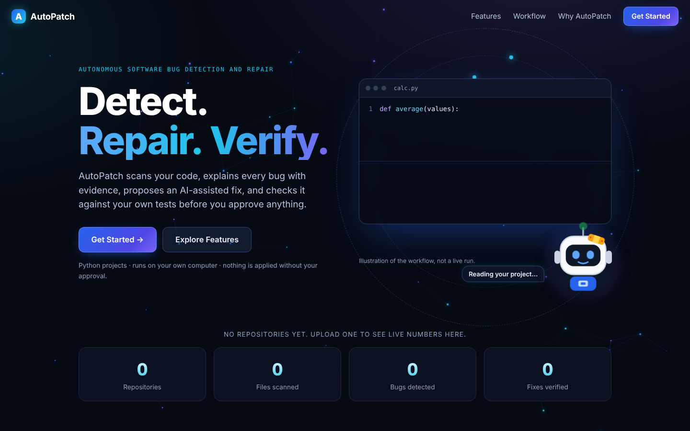
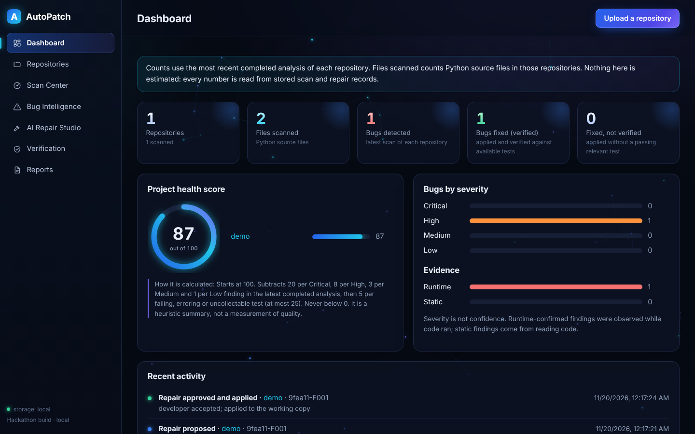
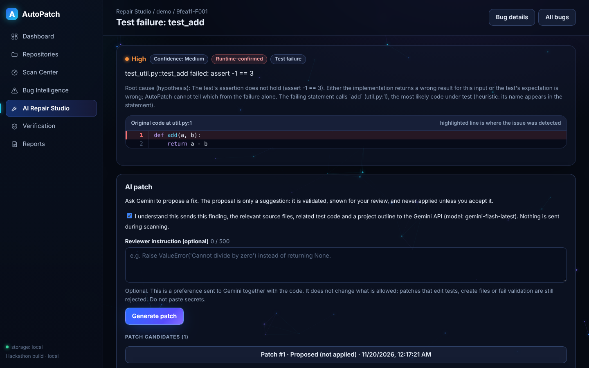
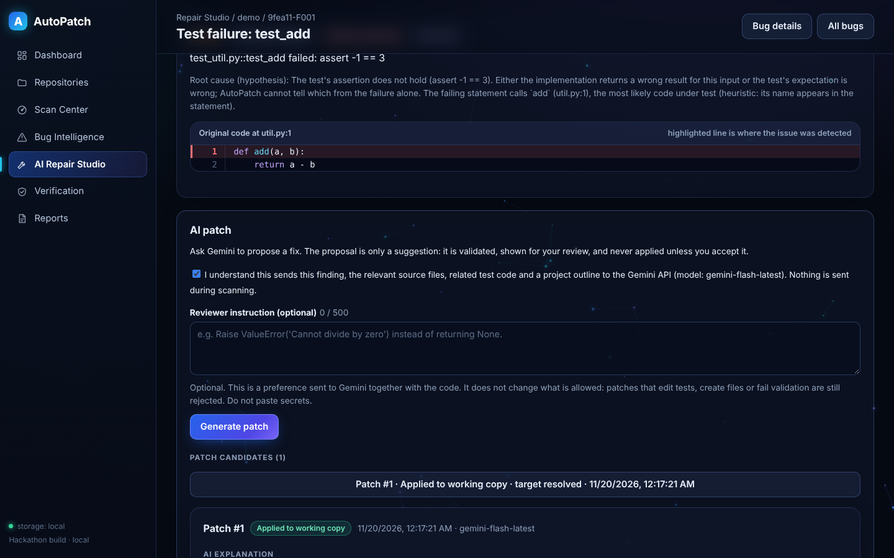

# AutoPatch

**Finds bugs in Python projects, explains them, proposes a fix with Gemini, tests the fix against your own tests, and applies it only after you approve. Every change can be rolled back.**

Built for the INNOVEDGE Hackathon 2026 (Problem Statement 02). A local prototype: it runs on your own computer and is not a hosted service.



## What makes it different

AutoPatch does not just suggest a fix. It reproduces the bug, checks a candidate fix against the project's tests, reverts fixes that cause regressions, and leaves the decision to you. Passing tests do not prove a fix is correct, so results say **"Verified against the available tests"** with real counts, never "fixed" or "safe".

## What works today

| Area | What it does |
|---|---|
| **Detect** | Runs your tests (pytest), Ruff, Bandit and AutoPatch's own checks, and runs up to three entry points once. Findings are labelled *runtime-confirmed* or *static, not confirmed*, with severity and confidence kept separate. |
| **Explain** | Each finding shows the evidence, a root-cause hypothesis, the triggering condition and the code. |
| **Repair** | Gemini proposes a unified diff. You see it side by side with the original, with side effects, suggested tests and a risk/confidence label. |
| **Verify** | Tests run before and after the patch in a throw-away copy. A regression is reverted automatically. |
| **Approve and roll back** | Nothing is applied without your approval. Rollback restores the files byte for byte and refuses to overwrite later edits. |
| **Report** | Dashboard, Verification Center and a Markdown report, all computed from stored results (nothing estimated). |





## Try it in 2 minutes (Windows, PowerShell)

Requires Python 3.10 or newer.

```powershell
git clone https://github.com/madhukushigowda-sudo/autopatch.git
cd autopatch
python -m venv .venv
.\.venv\Scripts\Activate.ps1          # if blocked:  Set-ExecutionPolicy -Scope Process Bypass
python -m pip install -r requirements.txt
python app.py                          # http://127.0.0.1:5000
```
If port 5000 is busy: `$env:PORT = "5001"` before `python app.py`.

**To use the AI repair step**, create a key in Google AI Studio and put it in `.env`:
```powershell
copy .env.example .env
notepad .env                           # GEMINI_API_KEY=your key, one line, no quotes
python scripts\gemini_rest_check.py    # sends one tiny request, no project code
```
Scanning works without a key. Only "Generate patch" needs one. If a model is overloaded, set another with `GEMINI_MODEL=` in `.env`.

**Then:**
1. Open `http://127.0.0.1:5000`, go to **Repositories**, and upload `demo/inventory_app.zip` (or `demo/bank_app.zip`). These are small projects with planted bugs.
2. In **Scan Center**, start a scan and watch the stages.
3. Open **Bug Intelligence**, choose a finding, and open it in **AI Repair Studio**.
4. Tick the consent box, press **Generate patch**, review the diff, then **Accept**. The verification result appears.
5. Optionally press **Rollback** to restore the original file.

## Safety

* **Secret guard:** before anything is sent to Gemini, the prompt is scanned for secrets (cloud keys, tokens, private keys, passwords). If one is found nothing is sent, and the message names the kind but never the value.
* **Consent:** nothing leaves your computer unless you tick the consent box, which lists what is sent.
* **Untrusted AI output:** the diff is strictly validated. Patches that edit tests, create/delete/rename files, touch unoffered files or do not apply are rejected.
* **Local only:** requests addressed to any host other than localhost are refused, and every page sends security headers and a Content-Security-Policy. This protects against hostile web pages. It is **not** authentication.
* **Key checks:** blank, placeholder or malformed Gemini keys are reported with a clear message before any request is made.
* **Originals are never modified.** Analysis and patches work on copies.
* **Windows diagnostics:** `python scripts\windows_check.py` shows which components are blocked or missing (for example by Application Control) and never tries to bypass anything.
* **Works when the Gemini SDK is blocked:** a built-in HTTPS client (standard library only) is used automatically. Control it with `GEMINI_TRANSPORT=auto|rest|sdk`.

## Storage

Local JSON files by default (`data/`). MongoDB Atlas is optional: set `MONGODB_URI` in `.env`. With `STORAGE_BACKEND=auto` AutoPatch falls back to local files if it cannot connect, and the top-right chip shows which is active. The Mongo path has not been tested against a live cluster by the developer of this build.

## Tests

```powershell
python scripts\check.py                # needs NO .env in the folder; about 2-4 minutes
```
It verifies file checksums, scans for leaked secrets, runs Ruff and the full test suite (450+ tests) in a clean environment. On Windows one test about an unreachable server may report a timeout instead of a network error, because Windows is slow to refuse a connection.

More detail: [`docs/CHANGELOG-backend-v2.md`](docs/CHANGELOG-backend-v2.md), [`docs/DETECTION-REPORT.md`](docs/DETECTION-REPORT.md), [`docs/PROTECTED-FILES-REPORT.md`](docs/PROTECTED-FILES-REPORT.md), [`docs/WINDOWS-TESTING.md`](docs/WINDOWS-TESTING.md).

## Limitations (please read)

* **Python projects only.**
* **Not a hardened sandbox and not production-ready.** Project code runs as your user and can read files, use the network and write outside the temporary folder. Only analyse code you are willing to run on your machine. Do not expose this server publicly.
* **Verification is only as good as the project's tests.** If no test exercises a finding, the result says the fix is insufficiently verified. Static and entry-point findings usually end that way.
* **Detection precision was measured on a small, hand-written corpus** (see the detection report). Do not read those numbers as general accuracy. Narrow `except X: pass` findings are reported as Low because they are often deliberate.
* **Root causes are hypotheses**, and risk/confidence labels are heuristics, not probabilities.
* **Flaky tests are not detected.** Each test runs once.
* Real Google requests, Bandit, MongoDB Atlas and container isolation were not tested in the build environment. Windows process-tree cleanup (`taskkill`) is untested.
* The scanner finds secrets by pattern and entropy and will miss some formats and flag some harmless strings. Add `# autopatch: allow-secret` to a line to allow a harmless test value.
* Importing from GitHub, patched-ZIP download and per-file approval are not available yet.

## Roadmap

Multi-language analysis, container-based isolation, user accounts and per-user data, patched-ZIP download, and a benchmark of measured repair results.
